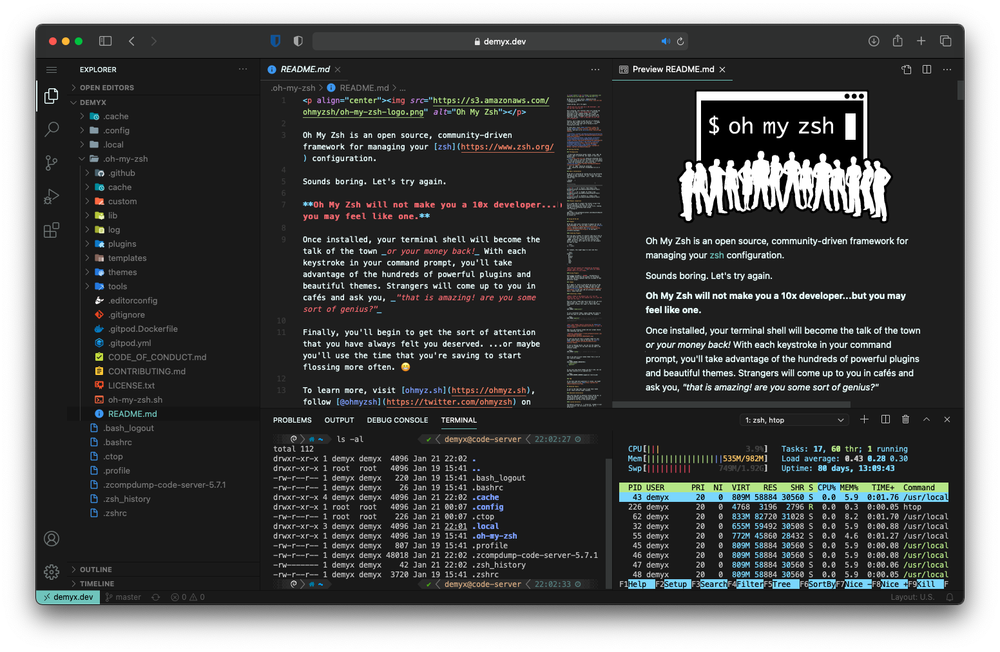

# code-server

code-server is VS Code running on a remote server, accessible through the browser.

To properly utilize this image, please use [Demyx](https://demyx.sh/readme).
- Repository - [demyxsh/demyx](https://github.com/demyxsh/demyx)
- Homepage - [demyx.sh](https://demyx.sh)

Join us on Discord for latest news, faster support, or just chill.

Support this project by buying coffee (please).

## PHP Security

This update addresses [CVE-2026-109618](https://github.com/php/php-src/security/advisories/GHSA-w8hw-w9fx-j79w) and [CVE-2026-109619](https://github.com/php/php-src/security/advisories/GHSA-6wmf-4rv5-p3rp) ([PHP advisory](https://www.php.net/archive/2026.php#2026-10-21-5)). The `wp` family uses PHP 8.3.36 for CLI/FPM. The `openlitespeed` family uses PHP 8.3.36 for CLI/FPM and retains its web-request selector for LiteSpeed PHP 8.3.36 or fallback 8.2.35. Admin PHP and legacy LSAPI aliases point to fixed PHP 8.3.36.

Rebuild and recreate containers to apply the update; existing images and running workers are unchanged. Rebuild the WP and OpenLiteSpeed parents with `--pull --no-cache`, tagging every image reference used by your Compose configuration. Then build each Bedrock child with `--no-cache` only so it reuses the freshly built local parent; do not pull the child's base before that patched parent is published.

Current Demyx defaults new sites to PHP 8.5, which these variants do not provide. For OpenLiteSpeed sites that should use its default PHP 8.3 branch, set `DEMYX_APP_OLS_LSPHP=8.3`. The WP image keeps its existing `DEMYX_PHP` interface; that variable does not switch its native PHP 8.3 CLI/FPM runtime.

This update covers only `wp`, `bedrock`, `openlitespeed`, and `openlitespeed-bedrock`, including their versioned and `v1` aliases. The unrelated `latest`, `go`, `browse`, and archive variants are unchanged. Other environment variables and defaults, image tags/variants, entrypoint and command interfaces, ports (WP 8080/9000/9001; OpenLiteSpeed 80/8080/8081/9000/9001), non-root UID 1000, and `/demyx`, `/home/demyx`, `/etc/demyx/custom`, and `/var/log/demyx` mounts are preserved. Only the OpenLiteSpeed base OS moves to Debian 12 Bookworm.
